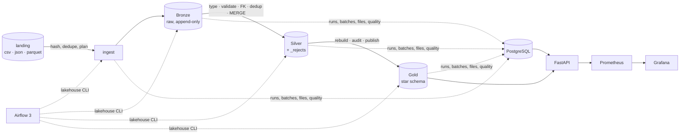

# Enterprise Lakehouse Platform

A runnable, tested data-engineering lab: a retail **medallion lakehouse** (Bronze → Silver → Gold) on
**PySpark 3.5 + Delta Lake 3.3**, with content-hash file tracking, batch control in **PostgreSQL**,
idempotent processing, a data-quality and reconciliation framework, **Airflow 3** orchestration, a
**FastAPI** query service, and **Prometheus/Grafana** observability — all local with Docker Compose and
**MinIO** (S3 API).

The focus is correctness under real failure modes: duplicated and re-sent files, malformed records,
schema drift, late and out-of-order data, crashes between systems, and historical reprocessing. Every
one of those has a test that asserts the invariants, and the synthetic data generator writes a manifest
of exactly what the platform must accept, reject and report.



## What is implemented

| Area | Highlights | Docs |
|---|---|---|
| Ingestion | SHA-256 file identity; duplicate files detected, intra-file duplicates preserved; batches with `run_id`/`batch_id`; DB-enforced single live registration | [ADR-0003](docs/adr/0003-file-identity-content-hash.md) |
| Bronze | one Delta commit per batch tagged with `batch_id`; crash-after-commit recovery; schema policy (capture / null-fill / quarantine) | [ADR-0004](docs/adr/0004-consistency-by-recovery.md), [ADR-0007](docs/adr/0007-controlled-schema-evolution.md) |
| Silver | native-Spark typing and normalization (dates in several layouts, offsets, money, ids); 134 row rules across 8 entities; FK policies; dedup by business key; guarded MERGE; rejects with reasons | [ADR-0005](docs/adr/0005-idempotent-silver-merge.md) |
| Gold | dimensions, sales-line fact, inventory fact, daily KPIs; write-audit-publish with version pinning | [ADR-0008](docs/adr/0008-gold-write-audit-publish.md) |
| Quality | row + dataset rules, BLOCKING vs WARNING, thresholds, volume anomaly, configurable business criteria | [data_quality.md](docs/data_quality.md) |
| Reconciliation | per-batch counts metadata ↔ Delta; Silver re-derived from Bronze (count, money, fingerprint); Gold ↔ Silver | [data_quality.md](docs/data_quality.md#reconciliation) |
| Orchestration | layer DAGs, full pipeline with per-entity Silver tasks, parameterized reprocessing | [operations.md](docs/operations.md) |
| API | `/health`, `/runs`, `/runs/{id}`, `/quality/results`, `/analytics/sales-summary`, `/metrics` | [architecture.md](docs/architecture.md) |
| Observability | JSON logs with correlation ids and secret redaction; metrics from metadata; alert rules; dashboard | [ADR-0010](docs/adr/0010-metrics-from-metadata.md) |

## Prerequisites

* Docker Engine with Compose v2 (tested: Docker 29.8, Compose 5.5) — for the full stack.
* For local development and tests: Python 3.12, [uv](https://docs.astral.sh/uv/) ≥ 0.12, Java 17.
* ~6 GB RAM free for the stack; first build downloads PySpark and the Delta/hadoop-aws jars.

## Quick start (Docker)

```bash
make env            # .env with random local secrets (never committed)
make up             # build and start everything; waits on health checks
make dag-check      # DAGs import and have the expected structure
make demo           # synthetic drop 1 → MinIO, then ingest → bronze → silver → gold → quality → reconcile
make demo-drop2     # incremental drop: updates, late sales, schema change, re-sent and incompatible files
make status
```

Or from Airflow (http://localhost:18088): trigger `lakehouse_demo_data`, then `lakehouse_pipeline`.

Then explore:

```bash
curl -s localhost:18000/health
curl -s 'localhost:18000/analytics/sales-summary?group_by=store' | jq
curl -s 'localhost:18000/quality/results?status=WARNED&limit=5' | jq
curl -s 'localhost:18000/runs?limit=5' | jq
docker compose exec airflow-scheduler /opt/lakehouse/venv/bin/lakehouse rejects --entity sale_items --limit 3
```

Grafana: http://localhost:13000 → *Lakehouse — Operations*. MinIO console: http://localhost:19011.

## Quick start (local, no Docker)

```bash
uv sync --all-extras
uv run lakehouse init                      # SQLite metadata + ./data/{landing,lake}
uv run lakehouse generate --scale small    # --drop 2 for the incremental scenario
uv run lakehouse run-all
uv run lakehouse status
```

## Data generation

```bash
lakehouse generate --drop 1 --scale small --seed 42 --files-per-entity 2 --error-rate 0.01
lakehouse generate --drop 2 ...                    # incremental changes on top of drop 1 (same seed)
lakehouse generate --scenarios none                # clean data
lakehouse generate --scenarios orphan_products,invalid_dates --store-skew 1.2
```

Scales: `tiny` (tests), `small`, `medium`, `large`. The manifest
(`<landing>/_manifests/drop_00N.json`) lists every injected anomaly and the expected Silver counts,
warnings and Gold totals; the integration tests assert against it.

## Tests

```bash
make test-fast        # unit, no Spark
make test-spark       # Spark unit tests + end-to-end local pipeline vs. the manifest
make test-resilience  # crash injection, re-runs, locks, blocked batches, late reference data, tampering
make up && make test-integration   # PostgreSQL + MinIO + delta-rs API, nothing mocked
make lint typecheck
```

Results of the last full run and the acceptance checklist: [docs/acceptance.md](docs/acceptance.md).

## Repository layout

```
src/lakehouse/
  contracts.py            entity contracts (single source of truth)
  config.py               YAML + LAKEHOUSE__* env configuration
  cli.py                  `lakehouse` command (used by Airflow, tests, benchmark)
  common/                 Spark session, object storage, failure checkpoints
  generator/              synthetic retail data + manifest
  ingestion/              discovery, hashing, batch planning (no Spark)
  metadata/               SQLAlchemy Core schema and repository
  pipelines/              bronze/, silver/, gold/, runner (facade), runtime (run tracking)
  quality/                framework, rule catalog, reconciliation, suites
  observability/          JSON logging, Prometheus collector
  api/                    FastAPI app, delta-rs Gold reader
dags/                     Airflow DAGs (orchestration only)
config/                   default configuration
infrastructure/           Dockerfiles, PostgreSQL init, Prometheus, Grafana
scripts/                  benchmark, docs generation, DAG check, env bootstrap
tests/{unit,integration,resilience}
docs/                     architecture, data dictionary, quality, operations, failures, benchmark, security, ADRs
```

## Documentation

[Architecture](docs/architecture.md) · [Data dictionary](docs/data_dictionary.md) ·
[Data quality](docs/data_quality.md) · [Operations](docs/operations.md) ·
[Failure scenarios](docs/failure_scenarios.md) · [Benchmark](docs/benchmark.md) ·
[Security](docs/security.md) · [ADRs](docs/adr/README.md) · [Initial assessment](docs/assessment.md) ·
[Acceptance](docs/acceptance.md)
