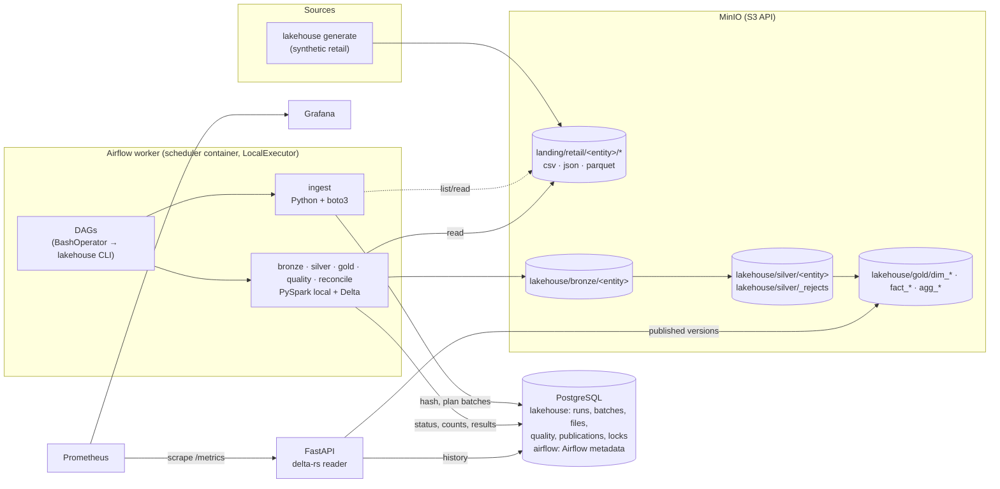
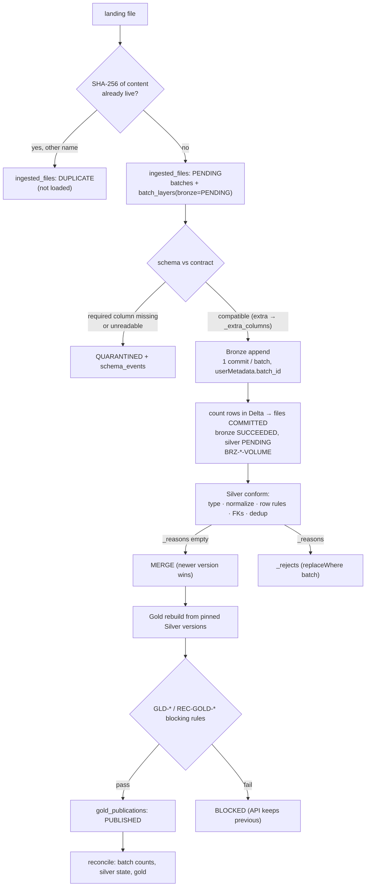

# Architecture

## Components



| Component | Responsibility | Code |
|---|---|---|
| Contracts | Columns, types, keys, FKs, formats per entity | `src/lakehouse/contracts.py` |
| Generator | Deterministic retail data + anomaly manifest | `src/lakehouse/generator/retail.py` |
| Ingestion | Discover files, SHA-256, duplicate detection, batch planning | `src/lakehouse/ingestion/discovery.py` |
| Bronze | Raw, append-only, lineage, schema policy, crash recovery | `src/lakehouse/pipelines/bronze/job.py` |
| Silver | Typing, normalization, row rules, FKs, dedup, MERGE, rejects | `src/lakehouse/pipelines/silver/` |
| Gold | Star schema, KPIs, write-audit-publish | `src/lakehouse/pipelines/gold/` |
| Quality | Rule framework, catalog, reconciliation | `src/lakehouse/quality/` |
| Metadata | Operational state in PostgreSQL | `src/lakehouse/metadata/` |
| Orchestration | Airflow DAGs calling the CLI | `dags/lakehouse_dags.py` |
| API | History, quality, analytics | `src/lakehouse/api/` |
| Observability | JSON logs, Prometheus metrics from metadata | `src/lakehouse/observability/` |

## Data flow



## Storage layout and tables

| Layer | Path | Partitioning | Write mode | Why |
|---|---|---|---|---|
| Landing | `s3://landing/retail/<entity>/<file>` | — | external | Files exactly as delivered. |
| Bronze | `s3://lakehouse/bronze/<entity>` | `_ingestion_date` | append-only | Replays and audits scan one or a few ingestion dates. |
| Silver | `s3://lakehouse/silver/<entity>` | `sale_month` for sales; others none | MERGE | Monthly partitions keep files large; dimension tables are small. |
| Rejects | `s3://lakehouse/silver/_rejects` | `entity` | replaceWhere per batch | Investigation is always per entity. |
| Gold | `s3://lakehouse/gold/<table>` | `sale_month` for the fact | overwrite + publish | Analytical queries filter by period. |

One table per entity and layer (never per file or batch). Daily partitions were rejected because at the
expected volume they would create many small files.

## Processing details

* **Spark session** (`common/spark.py`): one place for Delta extensions, UTC session time zone,
  `timeParserPolicy=CORRECTED` (invalid dates become NULL and are then rejected explicitly), ANSI off,
  `autoMerge` off, AQE on, S3A configuration only when an `s3://` URI is configured.
* **No Python UDFs**: parsing, validation, dedup and KPIs are native expressions; the only driver-side
  collections are small aggregates (per-batch counts, reason counts, rule outcomes).
* **Joins**: FK checks broadcast the dimension key sets (categories, products, customers, stores) and use a
  regular join for `sale_items → sales`; the Gold fact is persisted once and reused for the aggregate.
* **Explicit schemas**: Bronze (all text + lineage), Silver (from contracts), rejects; tables are created
  before the first write.

## Reprocessing sequence

```mermaid
sequenceDiagram
    autonumber
    actor Op as Operator / lakehouse_reprocess DAG
    participant CLI as lakehouse reprocess
    participant PG as PostgreSQL
    participant BR as Bronze (immutable)
    participant SV as Silver
    participant GD as Gold

    Op->>CLI: --entity sale_items --since 2026-10-01 (or --batch-id / --full-refresh)
    CLI->>PG: acquire lock silver:sale_items
    CLI->>PG: select Bronze-committed batches in range
    opt --full-refresh
        CLI->>SV: DELETE entity rows; DELETE its rejects
    end
    CLI->>PG: batch_layers(silver) = PENDING
    CLI->>PG: release lock
    CLI->>BR: read batches (partition-pruned)
    CLI->>SV: conform with current reference data
    CLI->>SV: MERGE (older versions never overwrite newer)
    CLI->>SV: replace rejects of those batches
    CLI->>PG: per-batch counts, quality results, SUCCEEDED
    CLI->>GD: rebuild from pinned Silver, audit
    CLI->>PG: gold_publications PUBLISHED (or BLOCKED)
    Op->>CLI: lakehouse reconcile
    CLI->>PG: REC-* results
```

## Why each layer exists

* **Bronze** makes every downstream state reproducible: Silver and Gold can always be rebuilt from it,
  and it answers "what exactly did the source send, when, in which file".
* **Silver** is the single conformed, deduplicated truth per entity, with every exclusion explained.
* **Gold** isolates consumption logic (what counts as revenue, how returns and anonymous customers are
  treated) from data conformance, and is only exposed after it passes its own checks.

## Idempotency summary

| Step | Re-run effect | Mechanism |
|---|---|---|
| ingest | no new batch, no new duplicate rows | content hash + `(uri, sha)` known check |
| bronze | no second append | pending-only batches; commit lookup by `batch_id` |
| silver | no change | guarded MERGE + reject replacement per batch |
| gold | identical content, new version, new publication | full rebuild from pinned Silver |
| quality / reconcile | new result rows only | read-only checks |

## Extension points (not in v1)

* Streaming/Kafka source: implement another planner that registers batches; Bronze/Silver are unchanged.
* Cluster execution: `LAKEHOUSE__SPARK__MASTER`; Kubernetes via `spark-submit --master k8s://`.
* Cloud object storage: change the endpoint/credentials; Delta multi-writer would need a log store.
* Incremental Gold: Silver tables already have change data feed enabled.
