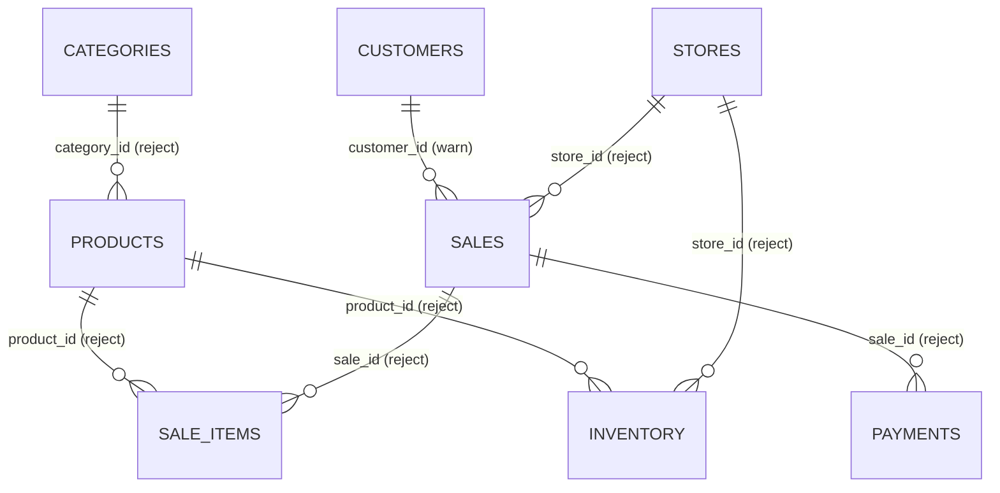

# Data dictionary

> Generated by `scripts/gen_docs.py` from `src/lakehouse/contracts.py` and the pipeline code. Do not edit by hand.

Retail demo domain with synthetic data (no real personal data). Timestamps are UTC. Money is
`decimal(18,2)` in BRL with a dot as decimal separator.

## Entities and relationships

## `categories`

Product categories (hierarchy of one optional parent level).

* Source format: **csv** · contract version 1
* Business key: `category_id` · versions ordered by `updated_at`
* Silver: unpartitioned

| Column | Silver type | Required | Meaning |
|---|---|---|---|
| `category_id` | string (id) | yes | Category business key. |
| `category_name` | string (string) | yes | Display name. |
| `parent_category_id` | string (id) | no | Optional parent category. |
| `updated_at` | timestamp (timestamp) | yes | Last change at the source (UTC). |

## `products`

Product catalog with list price and unit cost.

* Source format: **json** · contract version 1
* Business key: `product_id` · versions ordered by `updated_at`
* Silver: unpartitioned
* `category_id` -> `categories.category_id`: orphan records are rejected as `ORPHAN_CATEGORY`

| Column | Silver type | Required | Meaning |
|---|---|---|---|
| `product_id` | string (id) | yes | Product business key. |
| `sku` | string (id) | yes | Stock keeping unit. |
| `product_name` | string (string) | yes | Display name. |
| `category_id` | string (id) | yes | Category of the product. |
| `unit_price` | decimal(18,2) (money) | yes | Current list price (BRL). |
| `unit_cost` | decimal(18,2) (money) | no | Current unit cost (BRL). |
| `is_active` | boolean (boolean) | no | Whether the product is sold. |
| `updated_at` | timestamp (timestamp) | yes | Last change at the source (UTC). |

## `customers`

Registered customers. Contains personal data (synthetic) restricted to Silver.

* Source format: **csv** · contract version 1
* Business key: `customer_id` · versions ordered by `updated_at`
* Silver: unpartitioned

| Column | Silver type | Required | Meaning |
|---|---|---|---|
| `customer_id` | string (id) | yes | Customer business key. |
| `first_name` | string (string) | no | Personal data (synthetic). |
| `last_name` | string (string) | no | Personal data (synthetic). |
| `email` | string (email) | no | Personal data (synthetic). |
| `phone` | string (string) | no | Personal data (synthetic); optional, may be absent from newer files. |
| `city` | string (string) | no | City of residence. |
| `state` | string (code) | no | State code (UF). |
| `signup_date` | date (date) | yes | Registration date. |
| `updated_at` | timestamp (timestamp) | yes | Last change at the source (UTC). |

## `stores`

Physical and online stores.

* Source format: **csv** · contract version 1
* Business key: `store_id` · versions ordered by `updated_at`
* Silver: unpartitioned

| Column | Silver type | Required | Meaning |
|---|---|---|---|
| `store_id` | string (id) | yes | Store business key. |
| `store_name` | string (string) | yes | Display name. |
| `city` | string (string) | yes | City. |
| `state` | string (code) | yes | State code (UF). |
| `store_format` | string (code) | no | Store format. Allowed: STREET, MALL, ONLINE. |
| `opened_date` | date (date) | no | Opening date. |
| `updated_at` | timestamp (timestamp) | yes | Last change at the source (UTC). |

## `sales`

Sale and return headers. Returns carry negative totals by definition.

* Source format: **csv** · contract version 1
* Business key: `sale_id` · versions ordered by `updated_at`
* Silver partitioning: `sale_month`
* `store_id` -> `stores.store_id`: orphan records are rejected as `ORPHAN_STORE`
* `customer_id` -> `customers.customer_id`: orphans are accepted and reported by a warning rule

| Column | Silver type | Required | Meaning |
|---|---|---|---|
| `sale_id` | string (id) | yes | Sale business key. |
| `store_id` | string (id) | yes | Store where the transaction happened. |
| `customer_id` | string (id) | no | Registered customer; null for anonymous sales. |
| `sale_ts` | timestamp (timestamp) | yes | Transaction timestamp (UTC). |
| `transaction_type` | string (code) | yes | SALE or RETURN. Allowed: SALE, RETURN. |
| `status` | string (code) | yes | COMPLETED or CANCELLED. Allowed: COMPLETED, CANCELLED. |
| `total_amount` | decimal(18,2) (money) | yes | Net total; negative for returns. |
| `currency` | string (code) | yes | ISO currency code. |
| `original_sale_id` | string (id) | no | Sale being returned (returns only). |
| `updated_at` | timestamp (timestamp) | yes | Last change at the source (UTC). |
| `sale_date` | date | derived | Derived in Silver from `sale_ts`. |
| `sale_month` | string | derived | Derived in Silver from `sale_ts`. |

## `sale_items`

Sale lines. Quantity is negative on return lines.

* Source format: **parquet** · contract version 1
* Business key: `sale_id, line_number` · versions ordered by `updated_at`
* Silver: unpartitioned
* `sale_id` -> `sales.sale_id`: orphan records are rejected as `ORPHAN_SALE`
* `product_id` -> `products.product_id`: orphan records are rejected as `ORPHAN_PRODUCT`

| Column | Silver type | Required | Meaning |
|---|---|---|---|
| `sale_id` | string (id) | yes | Parent sale. |
| `line_number` | int (int) | yes | Line number within the sale. |
| `product_id` | string (id) | yes | Product sold. |
| `quantity` | int (int) | yes | Units; negative on return lines, never zero. |
| `unit_price` | decimal(18,2) (money) | yes | Unit price charged; never negative. |
| `discount_amount` | decimal(18,2) (money) | no | Line discount; never negative. |
| `line_total` | decimal(18,2) (money) | yes | quantity * unit_price - sign(quantity) * discount. |
| `updated_at` | timestamp (timestamp) | yes | Last change at the source (UTC). |

## `payments`

Payments and refunds of sales.

* Source format: **json** · contract version 1
* Business key: `payment_id` · versions ordered by `updated_at`
* Silver: unpartitioned
* `sale_id` -> `sales.sale_id`: orphan records are rejected as `ORPHAN_SALE`

| Column | Silver type | Required | Meaning |
|---|---|---|---|
| `payment_id` | string (id) | yes | Payment business key. |
| `sale_id` | string (id) | yes | Sale paid (or refunded). |
| `payment_method` | string (code) | yes | Payment method. Allowed: CREDIT_CARD, DEBIT_CARD, PIX, CASH. |
| `amount` | decimal(18,2) (money) | yes | Amount; negative only for REFUNDED payments. |
| `status` | string (code) | yes | Payment status. Allowed: APPROVED, DECLINED, REFUNDED. |
| `paid_ts` | timestamp (timestamp) | yes | Payment timestamp (UTC). |
| `updated_at` | timestamp (timestamp) | yes | Last change at the source (UTC). |

## `inventory`

Daily stock snapshot per store and product.

* Source format: **parquet** · contract version 1
* Business key: `store_id, product_id, snapshot_date` · versions ordered by `updated_at`
* Silver: unpartitioned
* `store_id` -> `stores.store_id`: orphan records are rejected as `ORPHAN_STORE`
* `product_id` -> `products.product_id`: orphan records are rejected as `ORPHAN_PRODUCT`

| Column | Silver type | Required | Meaning |
|---|---|---|---|
| `store_id` | string (id) | yes | Store. |
| `product_id` | string (id) | yes | Product. |
| `snapshot_date` | date (date) | yes | Snapshot date. |
| `quantity_on_hand` | int (int) | yes | Units on hand; negative means backorder. |
| `reorder_point` | int (int) | no | Replenishment threshold. |
| `updated_at` | timestamp (timestamp) | yes | Last change at the source (UTC). |

## Lineage columns

Bronze stores every business column as text plus these fields; Silver keeps a subset.

| Column | Bronze | Silver | Meaning |
|---|---|---|---|
| `_extra_columns` | yes | yes | JSON map of source columns not in the contract (schema drift captured, not lost). |
| `_corrupt_record` | yes | — | Raw text of a record Spark could not parse (wrong field count, invalid JSON). |
| `_record_hash` | yes | yes | SHA-256 of the business values as received. |
| `_batch_id` | yes | yes | Batch the record arrived in. |
| `_batch_seq` | yes | yes | Arrival order of the batch (tie-breaker between versions with equal updated_at). |
| `_run_id` | yes | — | Run that wrote the record. |
| `_source_file` | yes | yes | URI of the landing file. |
| `_source_file_sha256` | yes | — | Content hash of the landing file (its identity). |
| `_source_format` | yes | — | csv | json | parquet. |
| `_source_system` | yes | — | Configured source system name. |
| `_ingested_at` | yes | — | When Bronze wrote the record (UTC). |
| `_ingestion_date` | yes | — | Partition column: date the batch was planned. |
| `_silver_run_id` | — | yes | Run that last merged the record into Silver. |
| `_silver_processed_at` | — | yes | When the record was last merged (UTC). |

## `silver._rejects`

One row per rejected record, partitioned by `entity`; replaced per batch on re-runs.

| Column | Meaning |
|---|---|
| `entity` | Entity of the record. |
| `business_key` | Normalized business key as received (`|`-separated for composite keys). |
| `rejection_reason` | First (primary) reason code. |
| `rejection_reasons` | All reason codes, in evaluation order. |
| `raw_record` | JSON of the source values, extra columns and corrupt text. |
| `_batch_id`, `_batch_seq`, `_source_file`, `_record_hash` | Lineage. |
| `_run_id`, `rejected_at` | Run that rejected it and when. |

## Gold (star schema)

All Gold tables are rebuilt from a pinned Silver snapshot and served at the versions recorded in
`gold_publications` (see `docs/architecture.md`). Gold carries no direct personal identifiers.

| Table | Grain | Partitioning | Description |
|---|---|---|---|
| `dim_date` | day | — | Calendar covering the sales period (`date_key` = yyyyMMdd). |
| `dim_customer` | customer | — | `customer_key`, city, state, signup date; plus `ANONYMOUS` and `UNKNOWN` members. |
| `dim_product` | product | — | Product with category and parent category names, current price and cost. |
| `dim_store` | store | — | Store attributes. |
| `fact_sales_item` | sale line | `sale_month` | COMPLETED sale and return lines; returns have negative quantity and amounts. |
| `fact_inventory_snapshot` | store x product x day | — | Stock on hand with `is_backorder` and `below_reorder_point` flags. |
| `agg_daily_sales` | day x store | — | Daily KPIs; the source of `GET /analytics/sales-summary`. |

### `fact_sales_item`

| Column | Type | Meaning |
|---|---|---|
| `sale_id`, `line_number` | string, int | Natural key of the line. |
| `sale_ts`, `sale_date`, `sale_month`, `date_key` | timestamp, date, string, int | Transaction time (UTC) and derived calendar keys. |
| `store_id`, `product_id`, `category_id` | string | Dimension keys. |
| `customer_key` | string | Registered customer id, `ANONYMOUS` (no customer) or `UNKNOWN` (id not registered). |
| `source_customer_id` | string | Customer id exactly as on the sale, for traceability. |
| `transaction_type` | string | `SALE` or `RETURN`. |
| `quantity`, `unit_price`, `discount_amount` | int, decimal(18,2) | As in Silver. |
| `gross_amount` | decimal(18,2) | `quantity * unit_price`. |
| `net_amount` | decimal(18,2) | `line_total` from Silver (after discount; negative on returns). |
| `cost_amount` | decimal(18,2) | `quantity * current unit_cost` (SCD type 1). |
| `_gold_run_id` | string | Gold run that built the row. |

### `agg_daily_sales`

| Column | Meaning |
|---|---|
| `sale_date`, `date_key`, `store_id` | Grain. |
| `orders`, `returns` | Distinct SALE / RETURN transactions. |
| `items_sold` | Units on SALE lines. |
| `gross_revenue`, `discount_total` | Over SALE lines. |
| `returns_amount` | Net value of RETURN lines (negative). |
| `net_revenue` | Sum of `net_amount` (sales + returns). |
| `avg_ticket` | Net value of SALE lines / `orders`. |
| `gross_margin` | `net_revenue - cost_amount`. |

## Indicator catalog

Also stored in the metadata table `metric_definitions` on every publication.

| Metric | Formula | Filters | Sources |
|---|---|---|---|
| `net_revenue` | `SUM(fact_sales_item.net_amount)` | sales.status = 'COMPLETED' (SALE and RETURN lines) | silver.sales, silver.sale_items |
| `gross_revenue` | `SUM(quantity * unit_price) over SALE lines` | transaction_type = 'SALE' AND status = 'COMPLETED' | silver.sale_items |
| `discount_total` | `SUM(discount_amount) over SALE lines` | transaction_type = 'SALE' AND status = 'COMPLETED' | silver.sale_items |
| `returns_amount` | `SUM(net_amount) over RETURN lines` | transaction_type = 'RETURN' AND status = 'COMPLETED' | silver.sale_items |
| `orders` | `COUNT(DISTINCT sale_id) over SALE transactions` | transaction_type = 'SALE' AND status = 'COMPLETED' | silver.sales |
| `avg_ticket` | `SUM(net_amount of SALE lines) / orders` | transaction_type = 'SALE' AND status = 'COMPLETED' | silver.sale_items, silver.sales |
| `gross_margin` | `SUM(net_amount) - SUM(quantity * unit_cost)` | status = 'COMPLETED'; cost uses the current product cost (SCD type 1) | silver.sale_items, silver.products |
