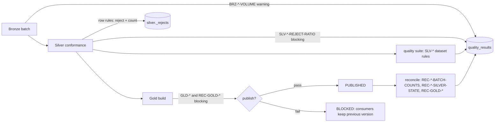

# Data quality and reconciliation

## Model

One framework (`src/lakehouse/quality/framework.py`), two kinds of rules, one result format.

| Kind | Where | Effect |
|---|---|---|
| **Row rules** | Silver conformance (`pipelines/silver/transform.py`) | The record is rejected to `silver._rejects` with a reason code; counts are recorded per batch. |
| **Dataset rules** | Quality suite, Gold publication gate, reconciliation | `BLOCKING` failures stop the step (CLI exit code 2); `WARNING` results are recorded only. |

Every result is stored in `quality_results` with: rule id, name, description, category, layer, table,
severity, records evaluated, violations, compliance %, threshold, status, observed/expected values,
details, batch id and run id. It is queryable through `GET /quality/results` and exported as
Prometheus metrics (`lakehouse_quality_rule_*`).

### Status

| Situation | Status |
|---|---|
| no violations | `PASSED` |
| violations within `threshold_pct` | `WARNED` |
| violations above threshold (or any, without threshold) | `FAILED` if BLOCKING, else `WARNED` |
| the check raised an exception | `ERROR` (a failure for BLOCKING rules — a broken check never passes) |

### Where each check runs



## Business criteria (configurable)

All in `config/lakehouse.yaml` (overridable with `LAKEHOUSE__BUSINESS_RULES__*` / `LAKEHOUSE__QUALITY__*`)
and covered by tests:

| Setting | Default | Meaning |
|---|---|---|
| `business_rules.max_future_days` | 1 | Dates later than now + N days are rejected (`FUTURE_DATE:<col>`). |
| `business_rules.min_valid_date` | 2015-01-01 | Earlier dates are rejected (`DATE_OUT_OF_RANGE:<col>`). |
| `business_rules.money_tolerance` | 0.01 | Tolerance of every financial consistency/reconciliation check. |
| `business_rules.allow_negative_stock` | true | Negative stock = backorder: warning only; `false` turns it into a row rule. |
| `business_rules.allowed_currencies` | [BRL] | `INVALID_CURRENCY` otherwise. |
| `quality.max_reject_ratio` | 0.25 | A batch with more rejects is **blocked**: rejects stored, nothing merged, step fails. |
| `quality.volume_anomaly.*` | lookback 5, min history 3, ratio 0.5–2.0 | Ingestion volume anomaly bounds. |

### Negative values are judged by meaning

* `sales.total_amount` is negative **by definition** for `RETURN` transactions (`POSITIVE_AMOUNT_FOR_RETURN`
  rejects the opposite); a negative `SALE` is rejected (`NEGATIVE_AMOUNT_FOR_SALE`).
* `sale_items.quantity` is negative on return lines; zero is rejected. `unit_price` and `discount_amount`
  are never negative.
* `payments.amount` may be negative only when `status = REFUNDED`.
* `inventory.quantity_on_hand < 0` is a backorder (warning `SLV-INVENTORY-NEG-STOCK`).
* `products.unit_cost > unit_price` is valid (clearance) but reported (`SLV-PRODUCTS-NEG-MARGIN`).

### Referential integrity policy

Per foreign key (`contracts.py`): `reject` (orphan record goes to rejects) or `warn` (accepted and
reported). `sales.customer_id` uses `warn`: revenue is never dropped because a customer registration is
late; Gold maps it to the `UNKNOWN` customer member. A late parent can be applied later with
`lakehouse reprocess` (see `docs/operations.md`).

## Reconciliation

| Rule | What it proves |
|---|---|
| `REC-<ENTITY>-BATCH-COUNTS` | For each batch: metadata counts = Delta counts, and Bronze rows = accepted + rejected. Detects lost or double-counted records between layers and metadata drift. |
| `REC-<ENTITY>-SILVER-STATE` | Silver = latest valid version per key re-derived from Bronze with the same code, compared on row count, monetary total and a hash fingerprint of the business columns. Detects lost/duplicated merges, out-of-band edits and late reference data. |
| `REC-GOLD-FACT-COUNT` / `-AMOUNT` | Gold fact rows and net amount = Silver lines of COMPLETED sales. |
| `REC-GOLD-AGG-AMOUNT` / `-ORDERS` | Daily aggregate = fact (amount) and = Silver (orders). |

The resilience suite deletes a Silver row out-of-band and asserts that `REC-SALES-SILVER-STATE`,
`REC-GOLD-FACT-COUNT` and `REC-GOLD-FACT-AMOUNT` fail, then that a full refresh repairs it.

## Querying rejected records

```bash
lakehouse rejects --entity sale_items --reason ORPHAN_PRODUCT --limit 5
```

```sql
-- Spark SQL
SELECT rejection_reason, count(*) FROM delta.`<lake>/silver/_rejects`
WHERE entity = 'sales' GROUP BY rejection_reason;
```

```sql
-- PostgreSQL: per-batch reason counts recorded by Silver
SELECT b.entity, l.batch_id, l.records_read, l.records_accepted, l.records_rejected, l.metrics->'reasons'
FROM batch_layers l JOIN batches b USING (batch_id) WHERE l.layer = 'silver' ORDER BY b.batch_seq;
```

## Rule catalog

<!-- BEGIN GENERATED RULES -->

### Row rules (Silver, per batch; violating records are rejected)

| Rule id | Reason code | Category | Description |
|---|---|---|---|
| `SLV-CATEGORIES-MALFORMED-RECORD` | `MALFORMED_RECORD` | validity | Record could not be parsed (wrong field count or JSON). |
| `SLV-CATEGORIES-MISSING-REQUIRED-category-id` | `MISSING_REQUIRED:category_id` | completeness | category_id is mandatory. |
| `SLV-CATEGORIES-MISSING-REQUIRED-category-name` | `MISSING_REQUIRED:category_name` | completeness | category_name is mandatory. |
| `SLV-CATEGORIES-MISSING-REQUIRED-updated-at` | `MISSING_REQUIRED:updated_at` | completeness | updated_at is mandatory. |
| `SLV-CATEGORIES-INVALID-FORMAT-updated-at` | `INVALID_FORMAT:updated_at` | validity | updated_at must be a valid timestamp. |
| `SLV-CATEGORIES-FUTURE-DATE-updated-at` | `FUTURE_DATE:updated_at` | validity | updated_at must not be later than now + 1 day(s). |
| `SLV-CATEGORIES-DATE-OUT-OF-RANGE-updated-at` | `DATE_OUT_OF_RANGE:updated_at` | validity | updated_at must not be earlier than 2015-01-01. |
| `SLV-CATEGORIES-DUPLICATE-BUSINESS-KEY` | `DUPLICATE_BUSINESS_KEY` | uniqueness | Only the latest version per ['category_id'] is kept. |
| `SLV-PRODUCTS-MALFORMED-RECORD` | `MALFORMED_RECORD` | validity | Record could not be parsed (wrong field count or JSON). |
| `SLV-PRODUCTS-MISSING-REQUIRED-product-id` | `MISSING_REQUIRED:product_id` | completeness | product_id is mandatory. |
| `SLV-PRODUCTS-MISSING-REQUIRED-sku` | `MISSING_REQUIRED:sku` | completeness | sku is mandatory. |
| `SLV-PRODUCTS-MISSING-REQUIRED-product-name` | `MISSING_REQUIRED:product_name` | completeness | product_name is mandatory. |
| `SLV-PRODUCTS-MISSING-REQUIRED-category-id` | `MISSING_REQUIRED:category_id` | completeness | category_id is mandatory. |
| `SLV-PRODUCTS-MISSING-REQUIRED-unit-price` | `MISSING_REQUIRED:unit_price` | completeness | unit_price is mandatory. |
| `SLV-PRODUCTS-INVALID-FORMAT-unit-price` | `INVALID_FORMAT:unit_price` | validity | unit_price must be a valid money. |
| `SLV-PRODUCTS-INVALID-FORMAT-unit-cost` | `INVALID_FORMAT:unit_cost` | validity | unit_cost must be a valid money. |
| `SLV-PRODUCTS-INVALID-FORMAT-is-active` | `INVALID_FORMAT:is_active` | validity | is_active must be a valid boolean. |
| `SLV-PRODUCTS-MISSING-REQUIRED-updated-at` | `MISSING_REQUIRED:updated_at` | completeness | updated_at is mandatory. |
| `SLV-PRODUCTS-INVALID-FORMAT-updated-at` | `INVALID_FORMAT:updated_at` | validity | updated_at must be a valid timestamp. |
| `SLV-PRODUCTS-FUTURE-DATE-updated-at` | `FUTURE_DATE:updated_at` | validity | updated_at must not be later than now + 1 day(s). |
| `SLV-PRODUCTS-DATE-OUT-OF-RANGE-updated-at` | `DATE_OUT_OF_RANGE:updated_at` | validity | updated_at must not be earlier than 2015-01-01. |
| `SLV-PRODUCTS-NEGATIVE-PRICE` | `NEGATIVE_PRICE` | validity | Product list price must not be negative. |
| `SLV-PRODUCTS-NEGATIVE-COST` | `NEGATIVE_COST` | validity | Product unit cost must not be negative. |
| `SLV-PRODUCTS-ORPHAN-CATEGORY` | `ORPHAN_CATEGORY` | referential_integrity | category_id must exist in silver.categories. |
| `SLV-PRODUCTS-DUPLICATE-BUSINESS-KEY` | `DUPLICATE_BUSINESS_KEY` | uniqueness | Only the latest version per ['product_id'] is kept. |
| `SLV-CUSTOMERS-MALFORMED-RECORD` | `MALFORMED_RECORD` | validity | Record could not be parsed (wrong field count or JSON). |
| `SLV-CUSTOMERS-MISSING-REQUIRED-customer-id` | `MISSING_REQUIRED:customer_id` | completeness | customer_id is mandatory. |
| `SLV-CUSTOMERS-MISSING-REQUIRED-signup-date` | `MISSING_REQUIRED:signup_date` | completeness | signup_date is mandatory. |
| `SLV-CUSTOMERS-INVALID-FORMAT-signup-date` | `INVALID_FORMAT:signup_date` | validity | signup_date must be a valid date. |
| `SLV-CUSTOMERS-FUTURE-DATE-signup-date` | `FUTURE_DATE:signup_date` | validity | signup_date must not be later than now + 1 day(s). |
| `SLV-CUSTOMERS-DATE-OUT-OF-RANGE-signup-date` | `DATE_OUT_OF_RANGE:signup_date` | validity | signup_date must not be earlier than 2015-01-01. |
| `SLV-CUSTOMERS-MISSING-REQUIRED-updated-at` | `MISSING_REQUIRED:updated_at` | completeness | updated_at is mandatory. |
| `SLV-CUSTOMERS-INVALID-FORMAT-updated-at` | `INVALID_FORMAT:updated_at` | validity | updated_at must be a valid timestamp. |
| `SLV-CUSTOMERS-FUTURE-DATE-updated-at` | `FUTURE_DATE:updated_at` | validity | updated_at must not be later than now + 1 day(s). |
| `SLV-CUSTOMERS-DATE-OUT-OF-RANGE-updated-at` | `DATE_OUT_OF_RANGE:updated_at` | validity | updated_at must not be earlier than 2015-01-01. |
| `SLV-CUSTOMERS-DUPLICATE-BUSINESS-KEY` | `DUPLICATE_BUSINESS_KEY` | uniqueness | Only the latest version per ['customer_id'] is kept. |
| `SLV-STORES-MALFORMED-RECORD` | `MALFORMED_RECORD` | validity | Record could not be parsed (wrong field count or JSON). |
| `SLV-STORES-MISSING-REQUIRED-store-id` | `MISSING_REQUIRED:store_id` | completeness | store_id is mandatory. |
| `SLV-STORES-MISSING-REQUIRED-store-name` | `MISSING_REQUIRED:store_name` | completeness | store_name is mandatory. |
| `SLV-STORES-MISSING-REQUIRED-city` | `MISSING_REQUIRED:city` | completeness | city is mandatory. |
| `SLV-STORES-MISSING-REQUIRED-state` | `MISSING_REQUIRED:state` | completeness | state is mandatory. |
| `SLV-STORES-INVALID-DOMAIN-store-format` | `INVALID_DOMAIN:store_format` | validity | store_format must be one of ['STREET', 'MALL', 'ONLINE']. |
| `SLV-STORES-INVALID-FORMAT-opened-date` | `INVALID_FORMAT:opened_date` | validity | opened_date must be a valid date. |
| `SLV-STORES-FUTURE-DATE-opened-date` | `FUTURE_DATE:opened_date` | validity | opened_date must not be later than now + 1 day(s). |
| `SLV-STORES-DATE-OUT-OF-RANGE-opened-date` | `DATE_OUT_OF_RANGE:opened_date` | validity | opened_date must not be earlier than 2015-01-01. |
| `SLV-STORES-MISSING-REQUIRED-updated-at` | `MISSING_REQUIRED:updated_at` | completeness | updated_at is mandatory. |
| `SLV-STORES-INVALID-FORMAT-updated-at` | `INVALID_FORMAT:updated_at` | validity | updated_at must be a valid timestamp. |
| `SLV-STORES-FUTURE-DATE-updated-at` | `FUTURE_DATE:updated_at` | validity | updated_at must not be later than now + 1 day(s). |
| `SLV-STORES-DATE-OUT-OF-RANGE-updated-at` | `DATE_OUT_OF_RANGE:updated_at` | validity | updated_at must not be earlier than 2015-01-01. |
| `SLV-STORES-DUPLICATE-BUSINESS-KEY` | `DUPLICATE_BUSINESS_KEY` | uniqueness | Only the latest version per ['store_id'] is kept. |
| `SLV-SALES-MALFORMED-RECORD` | `MALFORMED_RECORD` | validity | Record could not be parsed (wrong field count or JSON). |
| `SLV-SALES-MISSING-REQUIRED-sale-id` | `MISSING_REQUIRED:sale_id` | completeness | sale_id is mandatory. |
| `SLV-SALES-MISSING-REQUIRED-store-id` | `MISSING_REQUIRED:store_id` | completeness | store_id is mandatory. |
| `SLV-SALES-MISSING-REQUIRED-sale-ts` | `MISSING_REQUIRED:sale_ts` | completeness | sale_ts is mandatory. |
| `SLV-SALES-INVALID-FORMAT-sale-ts` | `INVALID_FORMAT:sale_ts` | validity | sale_ts must be a valid timestamp. |
| `SLV-SALES-FUTURE-DATE-sale-ts` | `FUTURE_DATE:sale_ts` | validity | sale_ts must not be later than now + 1 day(s). |
| `SLV-SALES-DATE-OUT-OF-RANGE-sale-ts` | `DATE_OUT_OF_RANGE:sale_ts` | validity | sale_ts must not be earlier than 2015-01-01. |
| `SLV-SALES-MISSING-REQUIRED-transaction-type` | `MISSING_REQUIRED:transaction_type` | completeness | transaction_type is mandatory. |
| `SLV-SALES-INVALID-DOMAIN-transaction-type` | `INVALID_DOMAIN:transaction_type` | validity | transaction_type must be one of ['SALE', 'RETURN']. |
| `SLV-SALES-MISSING-REQUIRED-status` | `MISSING_REQUIRED:status` | completeness | status is mandatory. |
| `SLV-SALES-INVALID-DOMAIN-status` | `INVALID_DOMAIN:status` | validity | status must be one of ['COMPLETED', 'CANCELLED']. |
| `SLV-SALES-MISSING-REQUIRED-total-amount` | `MISSING_REQUIRED:total_amount` | completeness | total_amount is mandatory. |
| `SLV-SALES-INVALID-FORMAT-total-amount` | `INVALID_FORMAT:total_amount` | validity | total_amount must be a valid money. |
| `SLV-SALES-MISSING-REQUIRED-currency` | `MISSING_REQUIRED:currency` | completeness | currency is mandatory. |
| `SLV-SALES-MISSING-REQUIRED-updated-at` | `MISSING_REQUIRED:updated_at` | completeness | updated_at is mandatory. |
| `SLV-SALES-INVALID-FORMAT-updated-at` | `INVALID_FORMAT:updated_at` | validity | updated_at must be a valid timestamp. |
| `SLV-SALES-FUTURE-DATE-updated-at` | `FUTURE_DATE:updated_at` | validity | updated_at must not be later than now + 1 day(s). |
| `SLV-SALES-DATE-OUT-OF-RANGE-updated-at` | `DATE_OUT_OF_RANGE:updated_at` | validity | updated_at must not be earlier than 2015-01-01. |
| `SLV-SALES-NEGATIVE-AMOUNT-FOR-SALE` | `NEGATIVE_AMOUNT_FOR_SALE` | validity | A SALE total must not be negative. |
| `SLV-SALES-POSITIVE-AMOUNT-FOR-RETURN` | `POSITIVE_AMOUNT_FOR_RETURN` | validity | A RETURN total must not be positive. |
| `SLV-SALES-RETURN-WITHOUT-ORIGINAL` | `RETURN_WITHOUT_ORIGINAL` | completeness | A RETURN must reference the original sale. |
| `SLV-SALES-INVALID-CURRENCY` | `INVALID_CURRENCY` | validity | Currency must be one of ['BRL']. |
| `SLV-SALES-ORPHAN-STORE` | `ORPHAN_STORE` | referential_integrity | store_id must exist in silver.stores. |
| `SLV-SALES-DUPLICATE-BUSINESS-KEY` | `DUPLICATE_BUSINESS_KEY` | uniqueness | Only the latest version per ['sale_id'] is kept. |
| `SLV-SALE_ITEMS-MALFORMED-RECORD` | `MALFORMED_RECORD` | validity | Record could not be parsed (wrong field count or JSON). |
| `SLV-SALE_ITEMS-MISSING-REQUIRED-sale-id` | `MISSING_REQUIRED:sale_id` | completeness | sale_id is mandatory. |
| `SLV-SALE_ITEMS-MISSING-REQUIRED-line-number` | `MISSING_REQUIRED:line_number` | completeness | line_number is mandatory. |
| `SLV-SALE_ITEMS-INVALID-FORMAT-line-number` | `INVALID_FORMAT:line_number` | validity | line_number must be a valid int. |
| `SLV-SALE_ITEMS-MISSING-REQUIRED-product-id` | `MISSING_REQUIRED:product_id` | completeness | product_id is mandatory. |
| `SLV-SALE_ITEMS-MISSING-REQUIRED-quantity` | `MISSING_REQUIRED:quantity` | completeness | quantity is mandatory. |
| `SLV-SALE_ITEMS-INVALID-FORMAT-quantity` | `INVALID_FORMAT:quantity` | validity | quantity must be a valid int. |
| `SLV-SALE_ITEMS-MISSING-REQUIRED-unit-price` | `MISSING_REQUIRED:unit_price` | completeness | unit_price is mandatory. |
| `SLV-SALE_ITEMS-INVALID-FORMAT-unit-price` | `INVALID_FORMAT:unit_price` | validity | unit_price must be a valid money. |
| `SLV-SALE_ITEMS-INVALID-FORMAT-discount-amount` | `INVALID_FORMAT:discount_amount` | validity | discount_amount must be a valid money. |
| `SLV-SALE_ITEMS-MISSING-REQUIRED-line-total` | `MISSING_REQUIRED:line_total` | completeness | line_total is mandatory. |
| `SLV-SALE_ITEMS-INVALID-FORMAT-line-total` | `INVALID_FORMAT:line_total` | validity | line_total must be a valid money. |
| `SLV-SALE_ITEMS-MISSING-REQUIRED-updated-at` | `MISSING_REQUIRED:updated_at` | completeness | updated_at is mandatory. |
| `SLV-SALE_ITEMS-INVALID-FORMAT-updated-at` | `INVALID_FORMAT:updated_at` | validity | updated_at must be a valid timestamp. |
| `SLV-SALE_ITEMS-FUTURE-DATE-updated-at` | `FUTURE_DATE:updated_at` | validity | updated_at must not be later than now + 1 day(s). |
| `SLV-SALE_ITEMS-DATE-OUT-OF-RANGE-updated-at` | `DATE_OUT_OF_RANGE:updated_at` | validity | updated_at must not be earlier than 2015-01-01. |
| `SLV-SALE_ITEMS-NEGATIVE-UNIT-PRICE` | `NEGATIVE_UNIT_PRICE` | validity | Unit price charged must not be negative. |
| `SLV-SALE_ITEMS-NEGATIVE-DISCOUNT` | `NEGATIVE_DISCOUNT` | validity | Discount must not be negative. |
| `SLV-SALE_ITEMS-ZERO-QUANTITY` | `ZERO_QUANTITY` | validity | Quantity must not be zero (negative only on returns). |
| `SLV-SALE_ITEMS-ORPHAN-SALE` | `ORPHAN_SALE` | referential_integrity | sale_id must exist in silver.sales. |
| `SLV-SALE_ITEMS-ORPHAN-PRODUCT` | `ORPHAN_PRODUCT` | referential_integrity | product_id must exist in silver.products. |
| `SLV-SALE_ITEMS-DUPLICATE-BUSINESS-KEY` | `DUPLICATE_BUSINESS_KEY` | uniqueness | Only the latest version per ['sale_id', 'line_number'] is kept. |
| `SLV-PAYMENTS-MALFORMED-RECORD` | `MALFORMED_RECORD` | validity | Record could not be parsed (wrong field count or JSON). |
| `SLV-PAYMENTS-MISSING-REQUIRED-payment-id` | `MISSING_REQUIRED:payment_id` | completeness | payment_id is mandatory. |
| `SLV-PAYMENTS-MISSING-REQUIRED-sale-id` | `MISSING_REQUIRED:sale_id` | completeness | sale_id is mandatory. |
| `SLV-PAYMENTS-MISSING-REQUIRED-payment-method` | `MISSING_REQUIRED:payment_method` | completeness | payment_method is mandatory. |
| `SLV-PAYMENTS-INVALID-DOMAIN-payment-method` | `INVALID_DOMAIN:payment_method` | validity | payment_method must be one of ['CREDIT_CARD', 'DEBIT_CARD', 'PIX', 'CASH']. |
| `SLV-PAYMENTS-MISSING-REQUIRED-amount` | `MISSING_REQUIRED:amount` | completeness | amount is mandatory. |
| `SLV-PAYMENTS-INVALID-FORMAT-amount` | `INVALID_FORMAT:amount` | validity | amount must be a valid money. |
| `SLV-PAYMENTS-MISSING-REQUIRED-status` | `MISSING_REQUIRED:status` | completeness | status is mandatory. |
| `SLV-PAYMENTS-INVALID-DOMAIN-status` | `INVALID_DOMAIN:status` | validity | status must be one of ['APPROVED', 'DECLINED', 'REFUNDED']. |
| `SLV-PAYMENTS-MISSING-REQUIRED-paid-ts` | `MISSING_REQUIRED:paid_ts` | completeness | paid_ts is mandatory. |
| `SLV-PAYMENTS-INVALID-FORMAT-paid-ts` | `INVALID_FORMAT:paid_ts` | validity | paid_ts must be a valid timestamp. |
| `SLV-PAYMENTS-FUTURE-DATE-paid-ts` | `FUTURE_DATE:paid_ts` | validity | paid_ts must not be later than now + 1 day(s). |
| `SLV-PAYMENTS-DATE-OUT-OF-RANGE-paid-ts` | `DATE_OUT_OF_RANGE:paid_ts` | validity | paid_ts must not be earlier than 2015-01-01. |
| `SLV-PAYMENTS-MISSING-REQUIRED-updated-at` | `MISSING_REQUIRED:updated_at` | completeness | updated_at is mandatory. |
| `SLV-PAYMENTS-INVALID-FORMAT-updated-at` | `INVALID_FORMAT:updated_at` | validity | updated_at must be a valid timestamp. |
| `SLV-PAYMENTS-FUTURE-DATE-updated-at` | `FUTURE_DATE:updated_at` | validity | updated_at must not be later than now + 1 day(s). |
| `SLV-PAYMENTS-DATE-OUT-OF-RANGE-updated-at` | `DATE_OUT_OF_RANGE:updated_at` | validity | updated_at must not be earlier than 2015-01-01. |
| `SLV-PAYMENTS-NEGATIVE-AMOUNT-FOR-PAYMENT` | `NEGATIVE_AMOUNT_FOR_PAYMENT` | validity | Only REFUNDED payments may be negative. |
| `SLV-PAYMENTS-POSITIVE-REFUND` | `POSITIVE_REFUND` | validity | A REFUNDED payment must not be positive. |
| `SLV-PAYMENTS-ORPHAN-SALE` | `ORPHAN_SALE` | referential_integrity | sale_id must exist in silver.sales. |
| `SLV-PAYMENTS-DUPLICATE-BUSINESS-KEY` | `DUPLICATE_BUSINESS_KEY` | uniqueness | Only the latest version per ['payment_id'] is kept. |
| `SLV-INVENTORY-MALFORMED-RECORD` | `MALFORMED_RECORD` | validity | Record could not be parsed (wrong field count or JSON). |
| `SLV-INVENTORY-MISSING-REQUIRED-store-id` | `MISSING_REQUIRED:store_id` | completeness | store_id is mandatory. |
| `SLV-INVENTORY-MISSING-REQUIRED-product-id` | `MISSING_REQUIRED:product_id` | completeness | product_id is mandatory. |
| `SLV-INVENTORY-MISSING-REQUIRED-snapshot-date` | `MISSING_REQUIRED:snapshot_date` | completeness | snapshot_date is mandatory. |
| `SLV-INVENTORY-INVALID-FORMAT-snapshot-date` | `INVALID_FORMAT:snapshot_date` | validity | snapshot_date must be a valid date. |
| `SLV-INVENTORY-FUTURE-DATE-snapshot-date` | `FUTURE_DATE:snapshot_date` | validity | snapshot_date must not be later than now + 1 day(s). |
| `SLV-INVENTORY-DATE-OUT-OF-RANGE-snapshot-date` | `DATE_OUT_OF_RANGE:snapshot_date` | validity | snapshot_date must not be earlier than 2015-01-01. |
| `SLV-INVENTORY-MISSING-REQUIRED-quantity-on-hand` | `MISSING_REQUIRED:quantity_on_hand` | completeness | quantity_on_hand is mandatory. |
| `SLV-INVENTORY-INVALID-FORMAT-quantity-on-hand` | `INVALID_FORMAT:quantity_on_hand` | validity | quantity_on_hand must be a valid int. |
| `SLV-INVENTORY-INVALID-FORMAT-reorder-point` | `INVALID_FORMAT:reorder_point` | validity | reorder_point must be a valid int. |
| `SLV-INVENTORY-MISSING-REQUIRED-updated-at` | `MISSING_REQUIRED:updated_at` | completeness | updated_at is mandatory. |
| `SLV-INVENTORY-INVALID-FORMAT-updated-at` | `INVALID_FORMAT:updated_at` | validity | updated_at must be a valid timestamp. |
| `SLV-INVENTORY-FUTURE-DATE-updated-at` | `FUTURE_DATE:updated_at` | validity | updated_at must not be later than now + 1 day(s). |
| `SLV-INVENTORY-DATE-OUT-OF-RANGE-updated-at` | `DATE_OUT_OF_RANGE:updated_at` | validity | updated_at must not be earlier than 2015-01-01. |
| `SLV-INVENTORY-ORPHAN-STORE` | `ORPHAN_STORE` | referential_integrity | store_id must exist in silver.stores. |
| `SLV-INVENTORY-ORPHAN-PRODUCT` | `ORPHAN_PRODUCT` | referential_integrity | product_id must exist in silver.products. |
| `SLV-INVENTORY-DUPLICATE-BUSINESS-KEY` | `DUPLICATE_BUSINESS_KEY` | uniqueness | Only the latest version per ['store_id', 'product_id', 'snapshot_date'] is kept. |

### Dataset rules

| Rule id | Severity | Category | Table | Description |
|---|---|---|---|---|
| `SLV-CATEGORIES-UNIQUE-KEY` | BLOCKING | uniqueness | `silver.categories` | Each ['category_id'] appears once in silver.categories; violations count the extra rows. |
| `SLV-CATEGORIES-NOT-NULL` | BLOCKING | completeness | `silver.categories` | Columns ['category_id', 'category_name', 'updated_at'] are never NULL in silver.categories. |
| `SLV-PRODUCTS-UNIQUE-KEY` | BLOCKING | uniqueness | `silver.products` | Each ['product_id'] appears once in silver.products; violations count the extra rows. |
| `SLV-PRODUCTS-NOT-NULL` | BLOCKING | completeness | `silver.products` | Columns ['product_id', 'sku', 'product_name', 'category_id', 'unit_price', 'updated_at'] are never NULL in silver.products. |
| `SLV-CUSTOMERS-UNIQUE-KEY` | BLOCKING | uniqueness | `silver.customers` | Each ['customer_id'] appears once in silver.customers; violations count the extra rows. |
| `SLV-CUSTOMERS-NOT-NULL` | BLOCKING | completeness | `silver.customers` | Columns ['customer_id', 'signup_date', 'updated_at'] are never NULL in silver.customers. |
| `SLV-STORES-UNIQUE-KEY` | BLOCKING | uniqueness | `silver.stores` | Each ['store_id'] appears once in silver.stores; violations count the extra rows. |
| `SLV-STORES-NOT-NULL` | BLOCKING | completeness | `silver.stores` | Columns ['store_id', 'store_name', 'city', 'state', 'updated_at'] are never NULL in silver.stores. |
| `SLV-SALES-UNIQUE-KEY` | BLOCKING | uniqueness | `silver.sales` | Each ['sale_id'] appears once in silver.sales; violations count the extra rows. |
| `SLV-SALES-NOT-NULL` | BLOCKING | completeness | `silver.sales` | Columns ['sale_id', 'store_id', 'sale_ts', 'transaction_type', 'status', 'total_amount', 'currency', 'updated_at'] are never NULL in silver.sales. |
| `SLV-SALE-ITEMS-UNIQUE-KEY` | BLOCKING | uniqueness | `silver.sale_items` | Each ['sale_id', 'line_number'] appears once in silver.sale_items; violations count the extra rows. |
| `SLV-SALE-ITEMS-NOT-NULL` | BLOCKING | completeness | `silver.sale_items` | Columns ['sale_id', 'line_number', 'product_id', 'quantity', 'unit_price', 'line_total', 'updated_at'] are never NULL in silver.sale_items. |
| `SLV-PAYMENTS-UNIQUE-KEY` | BLOCKING | uniqueness | `silver.payments` | Each ['payment_id'] appears once in silver.payments; violations count the extra rows. |
| `SLV-PAYMENTS-NOT-NULL` | BLOCKING | completeness | `silver.payments` | Columns ['payment_id', 'sale_id', 'payment_method', 'amount', 'status', 'paid_ts', 'updated_at'] are never NULL in silver.payments. |
| `SLV-INVENTORY-UNIQUE-KEY` | BLOCKING | uniqueness | `silver.inventory` | Each ['store_id', 'product_id', 'snapshot_date'] appears once in silver.inventory; violations count the extra rows. |
| `SLV-INVENTORY-NOT-NULL` | BLOCKING | completeness | `silver.inventory` | Columns ['store_id', 'product_id', 'snapshot_date', 'quantity_on_hand', 'updated_at'] are never NULL in silver.inventory. |
| `SLV-SALES-RI-CUSTOMER` | WARNING | referential_integrity | `silver.sales` | Sales whose customer_id is not in silver.customers (accepted by policy, reported). |
| `SLV-SALES-TOTAL-MISMATCH` | WARNING | consistency | `silver.sales` | Completed sales whose total_amount differs from the sum of line_total by more than the tolerance. |
| `SLV-PAYMENTS-TOTAL-MISMATCH` | WARNING | consistency | `silver.payments` | Completed sales whose APPROVED/REFUNDED payments do not add up to total_amount. |
| `SLV-SALE-ITEMS-LINE-TOTAL` | WARNING | consistency | `silver.sale_items` | line_total must equal quantity * unit_price - sign(quantity) * discount_amount. |
| `SLV-CUSTOMERS-DUP-EMAIL` | WARNING | uniqueness | `silver.customers` | Distinct customer ids sharing one e-mail: probable duplicate registrations. |
| `SLV-INVENTORY-NEG-STOCK` | WARNING | validity | `silver.inventory` | Snapshots with negative quantity_on_hand; allowed as backorders, monitored. |
| `SLV-PRODUCTS-NEG-MARGIN` | WARNING | validity | `silver.products` | Products whose unit_cost exceeds unit_price (clearance or pricing error). |
| `SLV-SALES-RETURN-ORIGINAL` | WARNING | referential_integrity | `silver.sales` | RETURN transactions whose original_sale_id is not in silver.sales. |
| `GLD-FACT-SALES-ITEM-UNIQUE-KEY` | BLOCKING | uniqueness | `gold.fact_sales_item` | Each ['sale_id', 'line_number'] appears once in gold.fact_sales_item; violations count the extra rows. |
| `GLD-AGG-DAILY-SALES-UNIQUE-KEY` | BLOCKING | uniqueness | `gold.agg_daily_sales` | Each ['sale_date', 'store_id'] appears once in gold.agg_daily_sales; violations count the extra rows. |
| `GLD-DIM-CUSTOMER-UNIQUE-KEY` | BLOCKING | uniqueness | `gold.dim_customer` | Each ['customer_key'] appears once in gold.dim_customer; violations count the extra rows. |
| `GLD-DIM-PRODUCT-UNIQUE-KEY` | BLOCKING | uniqueness | `gold.dim_product` | Each ['product_id'] appears once in gold.dim_product; violations count the extra rows. |
| `GLD-FACT-SALES-ITEM-NOT-NULL` | BLOCKING | completeness | `gold.fact_sales_item` | Columns ['sale_id', 'line_number', 'date_key', 'store_id', 'customer_key', 'product_id', 'net_amount'] are never NULL in gold.fact_sales_item. |
| `GLD-FACT-RI-DIM-PRODUCT` | BLOCKING | referential_integrity | `gold.fact_sales_item` | Every fact_sales_item.product_id exists in dim_product.product_id. |
| `GLD-FACT-RI-DIM-STORE` | BLOCKING | referential_integrity | `gold.fact_sales_item` | Every fact_sales_item.store_id exists in dim_store.store_id. |
| `GLD-FACT-RI-DIM-CUSTOMER` | BLOCKING | referential_integrity | `gold.fact_sales_item` | Every fact_sales_item.customer_key exists in dim_customer.customer_key. |
| `GLD-FACT-RI-DIM-DATE` | BLOCKING | referential_integrity | `gold.fact_sales_item` | Every fact_sales_item.date_key exists in dim_date.date_key. |
| `REC-GOLD-FACT-COUNT` | BLOCKING | reconciliation | `gold.fact_sales_item` | fact_sales_item rows = silver sale_items of COMPLETED sales. |
| `REC-GOLD-FACT-AMOUNT` | BLOCKING | reconciliation | `gold.fact_sales_item` | SUM(fact.net_amount) = SUM(silver.sale_items.line_total) of COMPLETED sales (within tolerance). |
| `REC-GOLD-AGG-AMOUNT` | BLOCKING | reconciliation | `gold.agg_daily_sales` | SUM(agg_daily_sales.net_revenue) = SUM(fact_sales_item.net_amount). |
| `REC-GOLD-AGG-ORDERS` | BLOCKING | reconciliation | `gold.agg_daily_sales` | SUM(agg_daily_sales.orders) = distinct COMPLETED SALE transactions with lines in Silver. |

<!-- END GENERATED RULES -->
